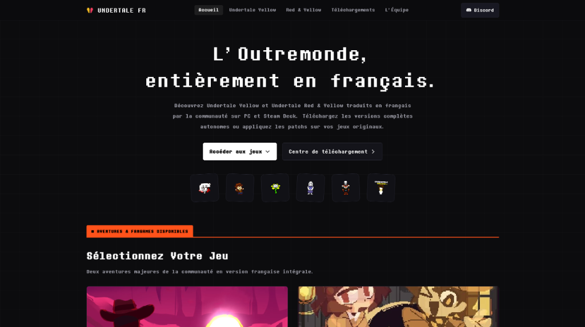

<div align="center">

# Undertale FR

**Portail Web & Vitrine Communautaire des Traductions Françaises d'Undertale**

[undertale-fr.cronos.build](https://undertale-fr.cronos.build) · [Dépôt Source](https://github.com/cronos-neo/undertale-fr) · [Patcher Rust](https://github.com/cronos-neo/undertale-fr-patcher)

<br/>

<p align="center">
  
</p>

</div>

---

## Vue d'ensemble

Undertale FR constitue la plateforme officielle de diffusion et de documentation pour les projets de localisation française indépendants :
- **Undertale Yellow FR** : Adaptation française intégrale de la préquelle officielle par Arvix (9 865 répliques, 2 494 scripts).
- **Undertale Red & Yellow FR** : Mod de continuité et réconciliation Clover/Chara par Shinix, adapté en français par Anthan.

La plateforme assure la distribution des paquets autonomes, des exécutables multiplateformes et des patchs différentiels xdelta3, tout en intégrant un environnement interactif pixel-art fidèle aux standards graphiques des jeux originaux.

---

## Caractéristiques Techniques

| Composant | Spécification |
|---|---|
| **Rendu & Interface** | Vanilla HTML5 / CSS3 sémantique, typographie pixel-art *Determination Mono* hébergée localement |
| **Performances Réseau** | Zéro dépendance externe CDN, polices auto-hébergées, politique de cache HTTP immuable |
| **Compatibilité Plateformes** | Linux (Ubuntu, Debian, Arch, Fedora), SteamOS (Steam Deck vérifié natif), Windows 64-bit |
| **Vérification d'Intégrité** | Table de hachage SHA-256 intégrée pour validation cryptographique avant exécution |
| **Interactivité & Moteur Audio** | Synthétiseur 8-bit natif via Web Audio API, gestion d'événements pixel art au clic |
| **Ergonomie Mobile** | Menu adaptatif compact, contraintes de défilement étanche sur écrans étroits |

---

## Architecture du Dépôt

```
undertale-fr/
├── assets/
│   ├── fonts/              # Polices locales (DeterminationMono, DTM-Sans)
│   └── images/             # Spritesheets, bannières et aperçus d'interface
├── css/
│   ├── base.css            # Système de design, typographie, interactions et responsive
│   └── game.css            # Grilles des fiches de jeux et stations de téléchargement
├── js/
│   ├── anthan-easter-egg.js # Module de variation textuelle et boîte de dialogue rétro
│   └── footer-world.js      # Scène interactive, synthétiseur audio et gestionnaire d'étoiles
├── index.html              # Point d'entrée principal du portail
├── telechargement.html     # Station de téléchargement et table d'intégrité SHA-256
├── undertale-yellow.html   # Fiche technique et distribution d'Undertale Yellow
├── undertale-red-yellow.html # Fiche technique et distribution de Red & Yellow
├── credits.html            # Documentation de l'équipe et crédits des auteurs originaux
├── faq.html                # Guide technique d'installation et résolution des anomalies
├── robots.txt              # Directives d'indexation
└── sitemap.xml             # Cartographie XML canonique
```

---

## Installation & Aperçu Local

Le portail ne requiert aucune étape de compilation ou dépendance tierce :

```bash
# Cloner le dépôt
git clone https://github.com/cronos-neo/undertale-fr.git
cd undertale-fr

# Lancer un serveur de développement local
python3 -m http.server 8080
# ou via Bun
bun x serve .
```

---

## Cadre Légal & Propriété Intellectuelle

Projet bénévole communautaire sans affiliation commerciale.
- **Undertale** est une marque et une œuvre originale créée par Toby Fox.
- **Undertale Yellow** est développé par Team UTY sous la direction de Master Sword.
- **Undertale Red & Yellow** est développé par Shinix.
- Les traductions françaises sont réalisées et maintenues de manière indépendante par leurs équipes respectives.
