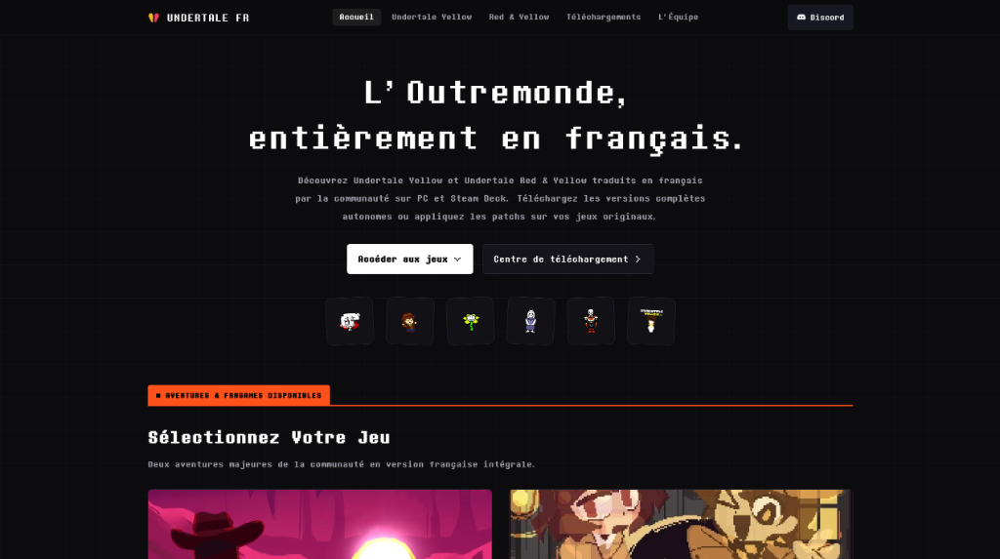

<div align="center">

# Undertale FR

**Portail web et vitrine communautaire des traductions francaises d'Undertale Yellow et Red & Yellow**

[undertale-fr.cronos.build](https://undertale-fr.cronos.build) · [Patcher Rust](https://github.com/cronos-neo/undertale-fr-patcher) · [Discord Communaute](https://discord.gg/mAwZBxhSSf)

<br/>

<p align="center">
  
</p>

</div>

---

## Communaute et Discord

Le portail web presente les projets de localisation francophone pour Undertale. Pour toute question technique, signalement de bug, retour sur les dialogues ou pour rejoindre l'equipe :

-> **[Rejoindre le Discord Undertale Yellow FR](https://discord.gg/mAwZBxhSSf)**

---

## Projets Couverts

- **Undertale Yellow FR** : Traduction francaise du fan-game Undertale Yellow coordonnee par Arvix.
- **Undertale Red & Yellow FR** : Mod de continuite cree par Shinix et adapte en francais par Anthan.

Pour appliquer les traductions, utilisez l'utilitaire multiplateforme disponible sur le depot [undertale-fr-patcher](https://github.com/cronos-neo/undertale-fr-patcher).

---

## Apercu Local du Site

Le portail est concu en HTML5, CSS3 et JavaScript sans build step obligatoire :

```bash
git clone https://github.com/cronos-neo/undertale-fr.git
cd undertale-fr

# Lancer un serveur local simple
python3 -m http.server 8080
```

---

## Liens Utiles

- Site en ligne : [undertale-fr.cronos.build](https://undertale-fr.cronos.build)
- Depot du patcher : [cronos-neo/undertale-fr-patcher](https://github.com/cronos-neo/undertale-fr-patcher)
- Serveur Discord : [https://discord.gg/mAwZBxhSSf](https://discord.gg/mAwZBxhSSf)
